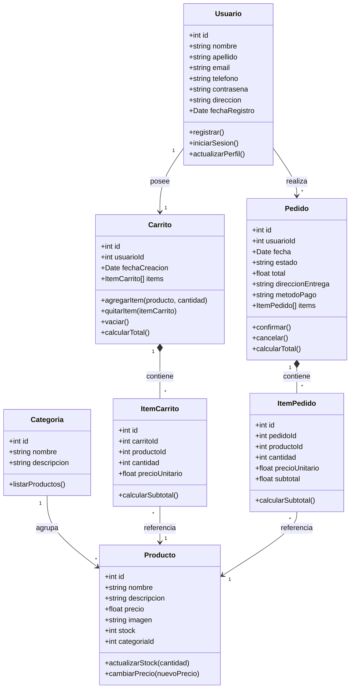

# Modelo del dominio - Churros Churroberto

Churrería de barrio (José Pascual Tamborini 6186, Buenos Aires) con venta online.

Las entidades se infieren a partir de las páginas del wireframe de baja fidelidad:

| Página del wireframe        | Entidades que aporta                     |
|-----------------------------|------------------------------------------|
| Login / Registro            | Usuario                                  |
| Catálogo de Productos       | Categoria, Producto                      |
| Detalle de Producto         | Producto (con su Categoria)              |
| Carrito de Compras          | Carrito, ItemCarrito, Pedido, ItemPedido |
| Inicio / Contacto           | (navegación, no generan entidades)       |

## Entidades principales

- **Usuario**: cliente que se registra e inicia sesión para comprar.
- **Categoria**: agrupación de productos dentro del catálogo (ej: Churros, Rellenos, Bebidas).
- **Producto**: cada ítem vendible, con su categoría, precio, descripción, imagen y stock.
- **Carrito**: carrito de compras activo de un usuario.
- **ItemCarrito**: línea del carrito (un producto y su cantidad).
- **Pedido**: compra confirmada por el usuario a partir del carrito.
- **ItemPedido**: línea del pedido (producto, cantidad y precio al momento de la compra).

## Diagrama de clases (Mermaid)

## Relaciones (resumen)

- Un **Usuario** posee un **Carrito** y realiza muchos **Pedidos**.
- Una **Categoria** agrupa muchos **Productos**; cada Producto pertenece a una Categoria.
- Un **Carrito** contiene muchos **ItemCarrito** (composición: si se elimina el carrito, se eliminan sus ítems).
- Un **Pedido** contiene muchos **ItemPedido** (composición).
- Cada **ItemCarrito** y cada **ItemPedido** referencian un **Producto**.

> Nota: los métodos listados corresponden al diseño del dominio. En la Entrega 1 las clases
> JavaScript de `Backend/src/models/` solo implementan el constructor y los atributos, sin lógica.
